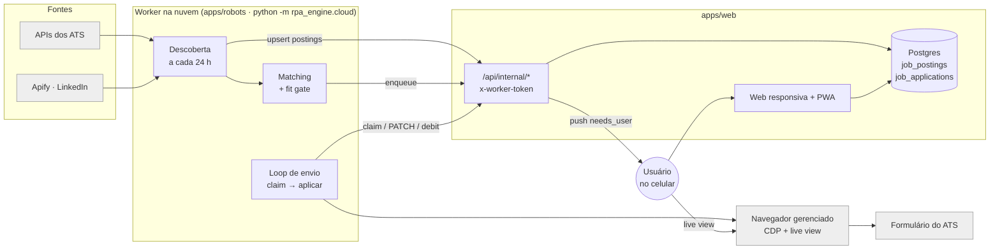
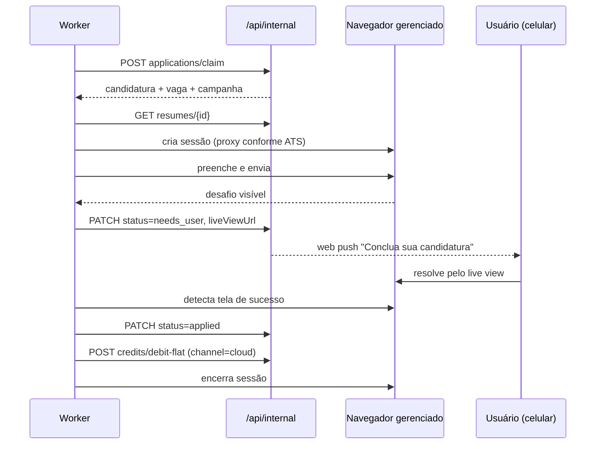

# SDD — Candidatura pela nuvem (Apliquefy no celular)

**Projeto:** Apliquefy
**Documento:** Software Design Document — envio de candidaturas pela nuvem
**Versão:** 1.0 — escrita contra o repositório (`feature/descoberta-nuvem-mobile` @ `59ebc43`)
**Responsável:** Luiz Lima
**Escopo:** `packages/database`, `apps/web` (Next.js) e `apps/robots` (engine Python, novo processo `cloud`)
**Base:** [descoberta/2026-11-08-viabilidade-nuvem-mobile.md](descoberta/2026-11-08-viabilidade-nuvem-mobile.md)

---

## 0. Escopo em uma frase

Uma campanha nova, do tipo **"Sites de empresas"** (`platform = ats`), roda inteira num worker na nuvem: descobre vagas, filtra, preenche o formulário do ATS e envia, sem o computador do usuário ligado. O usuário acompanha tudo pela web no celular.

O que **não** muda:

- LinkedIn e InfoJobs continuam no desktop, do jeito que estão. Nada em `engines/linkedin`, `engines/infojobs`, `apps/desktop` ou no fluxo `POST /runs` é alterado por este SDD.
- ATS que exigem conta do candidato (Gupy, Sólides, Workday) ficam fora da nuvem até a **Fase 7** (ADR-11), que vem depois do M1 e abre plataformas com login guardado num Context do Browserbase, começando pela Gupy.


---

## 1. Objetivo

Definir **como** implementar o envio pela nuvem: modelo de dados, contratos entre web e worker, ciclo de vida da candidatura, política de privacidade e plano de fases com critérios de aceite.

### 1.1 Problema

O Apliquefy só envia candidaturas com o desktop aberto, porque o engine roda como processo filho do Electron na máquina do usuário. Isso exclui quem só tem celular e quem não deixa o computador ligado.

O estudo de viabilidade mostrou que dá para tirar o envio da máquina do usuário para ATS com formulário público:

| ATS | Lê vagas sem login | Envia sem conta | Proteção |
|---|---|---|---|
| Greenhouse | API oficial, com as perguntas do formulário | sim | reCAPTCHA Enterprise invisível; às vezes código por e-mail |
| Lever | API oficial | sim | hCaptcha |
| Ashby | API oficial | sim | reCAPTCHA |
| Workable | API pública | sim | Cloudflare Turnstile |
| Recruitee, Breezy, Teamtailor, Quickin | API, JSON ou RSS públicos | sim | nenhum encontrado |
| SmartRecruiters | API pública | **bloqueou o robô** | — |
| Gupy, Sólides, Workday | sim | **não, exige conta** | login |

E três restrições do código atual impedem reaproveitar o engine como está:

1. **Toda rota que o engine chama autentica pela sessão Clerk do usuário** (`await auth()` em [debit-flat/route.ts](../apps/web/app/api/credits/debit-flat/route.ts), `job-applications`, `campaigns/[id]/runtime`). Um worker atende vários usuários e não tem a sessão de nenhum.
2. **`execute_apply` cria a candidatura e aplica no mesmo passo** ([apply_agent.py:274](../apps/robots/src/rpa_engine/runtime/apply_agent.py#L274)). Na nuvem a candidatura já existe antes, porque ela é o item da fila.
3. **`Job` é por campanha** ([schema.prisma](../packages/database/prisma/schema.prisma), `model Job`), com `numberOfApplications`. A nuvem precisa de um catálogo global de vagas, compartilhado entre usuários.

### 1.2 Objetivos mensuráveis

| ID | Objetivo | Métrica de sucesso |
|---|---|---|
| OBJ-1 | Enviar sem o computador do usuário | Campanha `ats` envia com o desktop fechado |
| OBJ-2 | Taxa de sucesso aceitável | ≥ 80% de `applied` sobre tentativas em Greenhouse (medido na Fase 0 e mantido em produção) |
| OBJ-3 | Usuário conclui pelo celular | Candidatura em `needs_user` notifica em < 1 min e expira em `HANDOFF_TIMEOUT_MIN` sem cobrar crédito |
| OBJ-4 | Margem positiva | Custo de infraestrutura por envio < receita dos créditos debitados por envio |
| OBJ-5 | Nada de currículo no worker depois do envio | Sessão do navegador encerrada e PDF apagado em 100% dos envios, com sucesso ou não. A gravação da sessão fica no Browserbase por até 30 dias (§9.3) |

---

## 2. Decisões de arquitetura

### ADR-01 — Rotas internas com token de serviço, chamando os mesmos services

Novas rotas em `apps/web/app/api/internal/*`, protegidas pelo cabeçalho `x-worker-token` comparado com `WORKER_API_TOKEN` (comparação em tempo constante). O `userId` vem no corpo da requisição.

Elas chamam **os mesmos services** das rotas públicas. `creditsService.debitFlat(userId, …)`, `jobApplicationService.createApplication(userId, …)` e `updateApplication(userId, id, …)` já recebem `userId` como primeiro argumento, então os services não mudam de assinatura. Só a borda muda: as rotas públicas tiram o `userId` do Clerk, e as internas o recebem do worker, já autenticado pelo token.

Hoje não há helper de token de serviço em `app/lib/auth/server/` (só `clerk.ts`). O helper novo fica em `app/lib/auth/server/worker.ts`.

**Por quê:** reaproveita a lógica de débito idempotente, reembolso em `failed` e checagem de dono da campanha, sem duplicar nada em Python.
**Rejeitado:** worker falando direto com o Postgres. Isso duplicaria em Python as regras de crédito e de reembolso, que hoje vivem só em TypeScript.

### ADR-02 — Fila no próprio Postgres (`FOR UPDATE SKIP LOCKED`), não RabbitMQ

A tarefa 5 do plano previa RabbitMQ no Railway. Nesta escala (dezenas a poucas centenas de envios por dia), uma fila em Postgres dá a mesma garantia (cada item é pego por um worker só) sem um serviço novo para operar, monitorar e pagar.

O claim é um `UPDATE … WHERE id IN (SELECT … FOR UPDATE SKIP LOCKED LIMIT n) RETURNING …`, exposto pela rota interna `claim` (§6.2).

**Caminho de upgrade:** RabbitMQ (ou SQS) quando houver mais de um tipo de worker consumindo, ou quando o polling de 30 s virar custo de banco perceptível. O contrato `claim` isola essa troca.

### ADR-03 — Catálogo global `job_postings`; a fila é a própria `JobApplication`

- **`JobPosting`** (novo, `job_postings`): uma linha por vaga no mundo, chave única na URL canônica. Alimentada pela descoberta, compartilhada por todos os usuários. `Job` continua como está, por campanha, para o desktop. A rota `POST /api/jobs` só trata `Job` e não é afetada.
- **Fila = `JobApplication`** com colunas novas (`jobPostingId`, `lockedAt`, `lockedBy`, `attempts`, `runAfter`, `liveViewUrl`, `needsUserUntil`). `pending` significa "na fila". Com isso:
  - `@@unique([userId, jobUrl])` já impede enfileirar a mesma vaga duas vezes para o mesmo usuário;
  - `/relatorios` mostra a fila sem mudança, como `pending`;
  - o caminho de reembolso em `failed` ([job-application.service.ts:120](../apps/web/backend/modules/job-application/job-application.service.ts#L120)) não é tocado. No fluxo da nuvem ele não chega a disparar, porque o débito só acontece depois de `applied` (§7.4).

**Rejeitado:** tabela separada `cloud_apply_tasks`. Ela duplicaria status e deduplicação e exigiria sincronizar dois estados para a mesma candidatura.

### ADR-04 — `Platform.ats` e `AppStatus.needs_user`; o modo vem da plataforma

- `Platform` ganha `ats`. Uma campanha `ats` é sempre nuvem; `linkedin` e `infojobs` são sempre desktop.
- A tarefa 4 pedia uma coluna `mode` (desktop|cloud). **Não entra agora:** hoje o modo é função da plataforma, e a coluna só vira necessária quando uma mesma plataforma rodar nos dois modos. Anotado em §15.
- `AppStatus` ganha `needs_user` (desafio visível ou código de verificação esperando o usuário).

**Raio de impacto** (tudo precisa mudar na mesma entrega):

| Onde | O que muda |
|---|---|
| [job-application.service.ts:220](../apps/web/backend/modules/job-application/job-application.service.ts#L220) | `summary` tem as chaves fixas `applied/failed/pending/skipped`; incluir `needs_user` |
| [validations/job-application.ts](../apps/web/app/lib/validations/job-application.ts) | `platformEnum` e `statusEnum` são `z.enum` fixos; incluir `ats` e `needs_user` |
| `app/lib/constants/campaign-options.ts` | regra do projeto: options 1:1 com os enums do Prisma |
| `app/(frontend)/relatorios/page.tsx` | rótulo e cor para `needs_user`; filtro por `ats` |
| `rpa_engine/runtime/state_machine.py` | só se o worker reaproveitar `Outcome` (§7.5) |

**Migração:** `ALTER TYPE … ADD VALUE` vai numa migração **só dela**. O Postgres não deixa usar um valor novo de enum na mesma transação que o criou.

### ADR-05 — Adapters determinísticos para os 3 ATS principais; agente como fallback

- **Greenhouse, Lever e Ashby** têm adapter determinístico, portado de `candidata/forms.py` (`FormFiller` + `Adapter`). No Greenhouse, as perguntas vêm de `GET boards-api.greenhouse.io/v1/boards/{token}/jobs/{id}?questions=true`, então o mapeamento campo → resposta é feito **antes** de abrir o navegador.
- **Os demais ATS sem conta** (Workable, Recruitee, Breezy, Teamtailor, Quickin) usam o agente do browser-use já existente em `execute_apply`, com um prompt de ATS genérico.
- A Fase 2 entrega **só Greenhouse**. Os outros entram na Fase 4.

**Por quê:** formulário conhecido não precisa de LLM por passo, o que deixa o envio mais barato, mais rápido e auditável. O agente cobre a cauda longa.

### ADR-06 — Navegador gerenciado via CDP, uma sessão por candidatura

- Provedor: Browserbase na Fase 0. Steel e Hyperbrowser expõem o mesmo contrato (CDP + live view) e ficam como alternativa. O próprio Apify também roda Playwright com proxy residencial; isso não foi avaliado.
- Conexão: Playwright `connect_over_cdp(cdp_url)` para os passos mecânicos e `BrowserSession(cdp_url=…)` do browser-use para o agente. O `browser-use>=0.13,<0.14` fixado em `apps/robots/pyproject.toml` aceita `cdp_url`.
- **Uma sessão nova por candidatura**, encerrada no fim, com sucesso ou não. Nada de cookie reaproveitado entre usuários.
- Proxy residencial ligado por ATS (flag em `ATS_PROXY`, §11), não global, porque é o item mais caro.
- A URL de live view da sessão vai para `JobApplication.liveViewUrl` quando a candidatura entra em `needs_user` (§8).

### ADR-07 — Fit gate por texto, antes de enfileirar

`fit_gate.passes()` hoje lê a descrição **da página aberta**. Na nuvem, a descrição já vem da API do ATS ou do Apify. Entra uma variante que recebe texto: `fit_gate.score_text(description, resume) -> FitVerdict`, reaproveitando o mesmo `_SYSTEM`, `should_skip` e `skip_reason`.

O gate roda **no matching, antes de criar a candidatura**. Vaga reprovada nem entra na fila. Ela vira `JobApplication` `skipped` com `errorLog` prefixado por `FIT:`, mesmo formato do desktop, então `/relatorios` já mostra o motivo.

O default continua **0 (gate desligado)**, pela regra atual de que o usuário escolhe ligar (`config.py`, comentário do `fit_min_score`). Ver §15.

### ADR-08 — O custo em créditos é decidido no servidor, por canal

`DebitFlatInput` ganha `channel: "desktop" | "cloud"` (default `desktop`). `creditsService.debitFlat` usa `CLOUD_COST_PER_APPLICATION` quando `channel = cloud` e `COST_PER_APPLICATION` no resto. O worker **não** decide preço.

O valor é uma decisão de negócio em aberto (o estudo sugere 3 a 5 créditos, ou um plano "Celular"). Ver §15. Até lá, o env fica sem default em produção e a rota recusa `channel = cloud` se ele não estiver definido.

### ADR-09 — Descoberta roda no worker, não em cron da Vercel

A execução de um ator do Apify leva minutos, e as funções da Vercel têm `maxDuration`. Por isso o worker do Railway roda a descoberta num agendamento próprio (`DISCOVERY_INTERVAL_HOURS`, default 24).

Fontes, em ordem de confiança:

1. **APIs públicas dos ATS** sobre uma lista de boards conhecidos (`ats_boards`). Código portado de `candidata/sources.py`.
2. **Apify** (`harvestapi/linkedin-job-search`) para vagas do LinkedIn, sem login. Devolve `applyMethod.companyApplyUrl` e `applicantTrackingSystem`. Cada URL de Greenhouse, Lever ou Ashby que aparecer alimenta `ats_boards`.
3. Uma execução única do `johnvc/greenhouse-job-board-api` em modo `companiesOnly` para semear `ats_boards` com cerca de 4.400 boards.

A URL canônica e a detecção de ATS são portadas de `candidata/jobs.py` (`canonical_url`, `detect_ats`).

### ADR-10 — Celular = web responsiva + PWA + web push

Não há app nativo. A web ganha manifest, service worker e web push (VAPID) para avisar que uma candidatura está em `needs_user`.

**Limitação:** no iOS, o push só chega se o usuário instalar o PWA na tela inicial (iOS 16.4+). O fallback é e-mail pelo Resend, que já está no backlog do projeto. Entra na Fase 6 (§13).

### ADR-11 — Plataformas com login via Contexts do Browserbase (Fase 7, depois do M1)

**Ordem:** Gupy primeiro (maior volume de vagas no Brasil), InfoJobs depois, LinkedIn por último.

O usuário conecta a conta uma vez. O Browserbase guarda os cookies de login num **Context** criptografado, um por usuário e plataforma. Depois disso, o worker abre sessões já logadas e se candidata sem o desktop. **O Apliquefy nunca guarda a senha:** o Context guarda só cookies, e a tabela `PlatformConnection` (§5) não tem coluna de credencial.

Dois caminhos de login, na ordem de preferência:

- **A) Live view.** O usuário digita e-mail, senha e código de verificação **dentro do navegador remoto**, pela tela ao vivo embutida na página do Apliquefy. Nada passa pelo servidor de vocês. É o caminho padrão.
- **B) Repasse de credencial.** O usuário digita num formulário do Apliquefy, e **a web** (não o worker) preenche a tela de login da plataforma via CDP, numa única requisição, sem gravar a senha (§6.6, §9.4). Só existe se o caminho A falhar no teste do teclado do celular, porque a documentação do Browserbase avisa que o teclado do celular não é oficialmente suportado no live view.

**LinkedIn só pelo caminho A.** O acordo de usuário do LinkedIn proíbe compartilhar a senha com terceiros, então `linkedin` fica fora do enum da rota de repasse (§6.6). É decisão do produto, registrada aqui de forma explícita.

**Rejeitado:** mandar a credencial para o worker. Como o worker só recebe trabalho pela fila no Postgres (ADR-02), a senha teria que ficar gravada no banco, mesmo que por segundos.

**Critério para desligar o desktop numa plataforma:** N semanas (a definir, §15) com contas de teste se candidatando todo dia pela nuvem sem nenhuma verificação forçada, restrição ou banimento.

---

## 3. Visão geral



Sequência de um envio com desafio visível:



---

## 4. Estrutura no monorepo

```
packages/database/prisma/
  migrations/<ts>_cloud_enums/          ALTER TYPE platform ADD VALUE 'ats'; app_status ADD VALUE 'needs_user'
  migrations/<ts>_cloud_apply/          job_postings, ats_boards, campaign_ats, colunas novas em job_applications
  migrations/<ts>_push_subscriptions/   (Fase 6)

apps/web/
  proxy.ts                              + '/api/internal(.*)' em isPublicRoute (§6.1)
  app/lib/auth/server/worker.ts         requireWorker(request) — compara x-worker-token
  app/api/internal/
    postings/upsert/route.ts            POST
    boards/route.ts                     GET (lista boards ativos) · POST (upsert)
    campaigns/active/route.ts           GET campanhas ats ativas + saldo do dia
    applications/enqueue/route.ts       POST
    applications/claim/route.ts         POST
    applications/[id]/route.ts          PATCH
    resumes/[id]/route.ts               GET
    credits/debit-flat/route.ts         POST
  app/api/campaigns/ats/route.ts        POST criar campanha ats (usuário, Clerk)
  app/api/push/subscribe/route.ts       POST (Fase 6)
  app/api/conexoes/[plataforma]/        iniciar · login · mfa · concluir · DELETE (Fase 7, §6.6)
  app/(frontend)/conexoes/[plataforma]/ tela de conexão com CSP própria (Fase 7, §9.4)
  backend/modules/platform-connection/  service + login-adapters/{gupy,infojobs}.ts (Fase 7)
  app/manifest.ts, public/sw.js         (Fase 6)
  backend/modules/job-posting/          schema Zod → service (upsert em lote)
  backend/modules/campaign/             + criação de campaign_ats
  backend/modules/credits/              + channel no debitFlat
  backend/modules/job-application/      + needs_user, colunas da fila, claim

apps/robots/src/rpa_engine/cloud/
  __main__.py          entrypoint: sobe o loop de envio e o agendador de descoberta
  config.py            CloudSettings a partir do env (§11)
  internal_client.py   cliente HTTP das rotas internas (token + userId)
  discovery/
    ats_sources.py     portado de candidata/sources.py
    apify.py           execução do ator e normalização
    canonical.py       portado de candidata/jobs.py (canonical_url, detect_ats)
  matching.py          termos, local, remoto, limite diário, fit gate por texto
  browser.py           cria/encerra sessão no provedor, devolve cdp_url e live view
  apply.py             ciclo de vida de uma candidatura (§7.4)
  adapters/
    base.py            contrato Adapter (portado de candidata/forms.py)
    greenhouse.py      Fase 2
    lever.py, ashby.py Fase 4
  handoff.py           detecção de desafio, espera do usuário, timeout
```

Reaproveitado sem cópia: `pdf/resume_pdf.py`, `util/resume.py` (`normalize`), `runtime/fit_gate.py` (com a variante por texto), `observability.py`.

---

## 5. Modelo de dados

Trechos de diff. Os nomes de coluna seguem o padrão do schema (`@map` em snake_case).

```prisma
enum Platform {
  linkedin
  infojobs
  ats            // novo — campanha que roda na nuvem
}

enum AppStatus {
  pending
  applied
  failed
  skipped
  needs_user     // novo — esperando o usuário concluir pelo live view
}

model JobPosting {
  id           String    @id @default(dbgenerated("gen_random_uuid()")) @db.Uuid
  canonicalUrl String    @unique @map("canonical_url") @db.VarChar
  applyUrl     String    @map("apply_url") @db.VarChar
  ats          String    @db.VarChar          // greenhouse|lever|ashby|workable|…|gupy|unknown
  boardToken   String?   @map("board_token") @db.VarChar
  externalId   String?   @map("external_id") @db.VarChar
  title        String    @db.VarChar
  companyName  String?   @map("company_name") @db.VarChar
  location     String?   @db.VarChar
  isRemote     Boolean?  @map("is_remote")
  description  String?                         // texto puro, até ~20 mil caracteres
  postedAt     DateTime? @map("posted_at") @db.Timestamp
  closedAt     DateTime? @map("closed_at") @db.Timestamp
  source       String    @db.VarChar           // ats_api | apify_linkedin
  sourceRef    String?   @map("source_ref") @db.VarChar  // ex.: id da vaga no LinkedIn
  firstSeenAt  DateTime  @default(now()) @map("first_seen_at") @db.Timestamp
  lastSeenAt   DateTime  @default(now()) @map("last_seen_at") @db.Timestamp

  applications JobApplication[]

  @@index([ats, lastSeenAt])
  @@map("job_postings")
}

model AtsBoard {
  id            String    @id @default(dbgenerated("gen_random_uuid()")) @db.Uuid
  ats           String    @db.VarChar
  token         String    @db.VarChar
  companyName   String?   @map("company_name") @db.VarChar
  active        Boolean   @default(true)
  lastFetchedAt DateTime? @map("last_fetched_at") @db.Timestamp

  @@unique([ats, token])
  @@map("ats_boards")
}

model CampaignAts {
  id           String    @id @default(dbgenerated("gen_random_uuid()")) @db.Uuid
  campaignId   String    @unique @map("campaign_id") @db.Uuid
  searchTerms  String    @map("search_terms") @db.VarChar
  locationTerm String?   @map("location_term") @db.VarChar
  remoteOnly   Boolean   @default(false) @map("remote_only")
  atsAllowlist String[]  @map("ats_allowlist")   // vazio = todos os suportados
  fitMinScore  Int       @default(0) @map("fit_min_score")

  campaign Campaign? @relation(fields: [campaignId], references: [id])

  @@map("campaign_ats")
}

model JobApplication {
  // … campos atuais inalterados …
  jobPostingId   String?   @map("job_posting_id") @db.Uuid
  ats            String?   @db.VarChar
  attempts       Int       @default(0)
  lockedAt       DateTime? @map("locked_at") @db.Timestamp
  lockedBy       String?   @map("locked_by") @db.VarChar
  runAfter       DateTime? @map("run_after") @db.Timestamp
  liveViewUrl    String?   @map("live_view_url") @db.VarChar
  needsUserUntil DateTime? @map("needs_user_until") @db.Timestamp

  jobPosting JobPosting? @relation(fields: [jobPostingId], references: [id])

  @@index([platform, status, runAfter])   // usado pelo claim
}
```

`Campaign` ganha `atsConfig CampaignAts?`, ao lado de `linkedinConfig` e `infojobsConfig`.

`JobApplication.jobUrl` recebe a **URL canônica** da vaga, para que o `@@unique([userId, jobUrl])` deduplique a mesma vaga vinda de fontes diferentes (Apify e API do ATS).

**Fase 7 (ADR-11):**

```prisma
enum ConnectedPlatform {
  gupy
  infojobs
  linkedin
}

enum ConnectionStatus {
  pending     // sessão de login aberta, esperando o usuário
  connected
  expired     // o worker caiu na tela de login: o usuário precisa reconectar
  revoked     // o usuário desconectou; o Context foi apagado no Browserbase
}

// Por desenho NÃO existe coluna de senha, e-mail de login ou código de verificação.
// A credencial nunca é persistida; só os cookies, dentro do Context do Browserbase.
model PlatformConnection {
  id               String            @id @default(dbgenerated("gen_random_uuid()")) @db.Uuid
  userId           String            @map("user_id")
  platform         ConnectedPlatform
  contextId        String?           @map("context_id") @db.VarChar   // Context no Browserbase
  status           ConnectionStatus  @default(pending)
  sessionId        String?           @map("session_id") @db.VarChar   // só durante o login
  sessionExpiresAt DateTime?         @map("session_expires_at") @db.Timestamp
  loginSucceededAt DateTime?         @map("login_succeeded_at") @db.Timestamp // trava o 2º login na mesma conexão
  consentAt        DateTime          @map("consent_at") @db.Timestamp
  connectedAt      DateTime?         @map("connected_at") @db.Timestamp
  lastCheckedAt    DateTime?         @map("last_checked_at") @db.Timestamp
  revokedAt        DateTime?         @map("revoked_at") @db.Timestamp

  @@unique([userId, platform])
  @@map("platform_connections")
}

// Rate limit da rota de login (§9.4). No Postgres, coerente com o ADR-02: não há Redis no stack.
model LoginAttempt {
  id        String            @id @default(dbgenerated("gen_random_uuid()")) @db.Uuid
  userId    String            @map("user_id")
  platform  ConnectedPlatform
  ipHash    String            @map("ip_hash") @db.VarChar   // SHA-256 do IP com salt, nunca o IP puro
  outcome   String            @db.VarChar                   // success | mfa_required | invalid_credentials | challenge | unknown | blocked
  createdAt DateTime          @default(now()) @map("created_at") @db.Timestamp

  @@index([userId, platform, createdAt])
  @@index([ipHash, createdAt])
  @@map("login_attempts")
}
```

---

## 6. Design — `apps/web`

### 6.1 Guarda das rotas internas

`requireWorker(request)` lê `x-worker-token`, compara com `WORKER_API_TOKEN` via `crypto.timingSafeEqual` e devolve 401 se não bater ou se o env estiver vazio. Toda rota em `api/internal/*` começa por ele. As rotas internas **não** aceitam sessão Clerk, e as públicas **não** aceitam o token. Os dois caminhos não se misturam.

**Pré-requisito no `proxy.ts`:** o [proxy.ts](../apps/web/proxy.ts) roda `auth.protect()` em toda rota `/api/*` que não esteja em `isPublicRoute`. Sem mudança, o worker leva 401 do Clerk antes de chegar ao `requireWorker`. Inclua `'/api/internal(.*)'` em `isPublicRoute`; a partir daí o `requireWorker` é o único guarda dessas rotas, então nenhuma rota interna pode existir sem ele.

Toda rota interna que recebe `userId` repassa a checagem de dono para o service: a campanha precisa pertencer ao `userId`, como já acontece hoje. Assim, um token vazado não permite escrever na campanha de outro usuário por um id inventado.

### 6.2 Contratos

Todos recebem e devolvem JSON e validam o corpo com Zod (convenção do projeto). Erros seguem `{ message, errorDesc }`.

| Rota | Corpo / query | Faz | Resposta |
|---|---|---|---|
| `POST internal/postings/upsert` | `{ postings: JobPostingInput[] }` (até 500) | upsert por `canonicalUrl`; atualiza `lastSeenAt`; marca `closedAt` quando a fonte diz que fechou | `{ upserted, created }` |
| `GET internal/boards?ats=` | — | boards ativos para a descoberta | `AtsBoard[]` |
| `POST internal/boards` | `{ boards: {ats, token, companyName?}[] }` | upsert por `(ats, token)` | `{ created }` |
| `GET internal/campaigns/active` | — | campanhas `ats` ativas, com config, `resumeId`, `userId`, vagas restantes hoje (`dailyLimit − applied − pending − needs_user` do dia) e saldo de créditos | lista |
| `POST internal/applications/enqueue` | `{ userId, campaignId, jobPostingId, runAfter? }` | `createApplication(userId, …)` com `platform=ats`, `jobUrl=canonicalUrl` e colunas da fila; nasce `pending` | 201 · 409 se já existe |
| `POST internal/applications/claim` | `{ workerId, limit }` | claim com `SKIP LOCKED` (abaixo) | itens com candidatura, vaga e campanha |
| `PATCH internal/applications/{id}` | `{ userId, status?, errorLog?, liveViewUrl?, needsUserUntil?, runAfter? }` | `updateApplication(userId, id, …)`; libera `lockedAt` se o status for final; dispara push em `needs_user` (Fase 6) | candidatura |
| `GET internal/resumes/{id}?userId=` | — | currículo do usuário (mesma checagem de dono) | JSON do currículo |
| `POST internal/credits/debit-flat` | `{ userId, …DebitFlatInput, channel: "cloud" }` | `debitFlat(userId, …)` | igual à rota pública |

Claim (SQL bruto via `$queryRaw`, dentro de uma transação):

```sql
UPDATE job_applications
   SET locked_at = now(), locked_by = $workerId, attempts = attempts + 1
 WHERE id IN (
   SELECT id FROM job_applications
    WHERE platform = 'ats' AND status = 'pending'
      AND (run_after IS NULL OR run_after <= now())
      AND (locked_at IS NULL OR locked_at < now() - interval '15 minutes')
      AND attempts < 3
    ORDER BY created_at
    FOR UPDATE SKIP LOCKED
    LIMIT $limit)
RETURNING id;
```

`locked_at` mais velho que 15 minutos é tratado como worker morto, e o item volta para a fila. Um item com `attempts >= 3` ainda em `pending` vira `failed` pelo varredor da §7.6. Nenhum crédito foi cobrado nesse caso, porque o débito só acontece depois de `applied` (§7.4).

### 6.3 Créditos

- `debitFlatSchema` ganha `channel: z.enum(["desktop","cloud"]).default("desktop")`.
- `debitFlat` usa o custo base `CLOUD_COST_PER_APPLICATION` quando `channel = cloud`. As regras de custo por pergunta e de teto continuam valendo.
- Idempotência, chave de reembolso `refund:application:<id>` e histórico de transações ficam iguais.
- `campaigns/active` só devolve campanha cujo usuário tenha saldo para pelo menos um envio na nuvem. Sem saldo, nada é enfileirado.

### 6.4 Telas

| Tela | Mudança |
|---|---|
| `/campanhas/nova` | terceiro tipo: **"Sites de empresas (roda na nuvem)"**, com termos, local, só remoto, ATS permitidos e nota mínima de aderência; explica que não precisa do desktop |
| `/campanhas` | badge "Nuvem" nas campanhas `ats`; o botão ativar não pede sessão do desktop |
| `/relatorios` | status `needs_user` com rótulo "Precisa de você" e link para concluir; filtro por ATS |
| `/dashboard` | faixa no topo quando houver candidatura em `needs_user`, com contagem regressiva até `needsUserUntil` |
| `/candidaturas/[id]/concluir` | página para celular: explica o desafio e abre o `liveViewUrl` numa aba nova (o iframe do provedor pode ser bloqueado pelo CSP dele) |
| Todas acima | revisão em 375 px (tarefa 13) |

### 6.5 PWA e push (Fase 6)

- `app/manifest.ts` (rota de manifest nativa do App Router), ícones da identidade visual e `display: standalone`.
- `public/sw.js` só com os handlers `push` e `notificationclick` (abre `/candidaturas/[id]/concluir`). Nada de cache offline nesta entrega.
- `POST /api/push/subscribe` (Clerk) grava `PushSubscription { userId, endpoint @unique, p256dh, auth }`.
- O PATCH interno para `needs_user` envia o push com `web-push` (VAPID). Assinatura que responder 404/410 é apagada.
- Fallback por e-mail (Resend) quando o usuário não tiver nenhuma assinatura ativa.

---

### 6.6 Conexão de plataformas com login (Fase 7)

Rotas **do usuário**, protegidas pelo Clerk. Elas **não** ficam em `/api/internal`. Todas validam `plataforma` com `z.enum` e checam que a `PlatformConnection` pertence ao `userId`; se não pertencer, respondem **404** (não 403, para não confirmar que o id existe).

| Rota | Corpo | Faz | Resposta |
|---|---|---|---|
| `POST /api/conexoes/{plataforma}/iniciar` | `{ consentimento: true }` | grava `consentAt`; cria o Context (ou reusa o da conexão); cria a sessão com `context: { id, persist: true }`, `allowedDomains` da plataforma, `logSession: false`, `keepAlive` e timeout de 10 min; abre a página de login; grava `sessionId` e `sessionExpiresAt` | `{ connectionId, liveViewUrl }` |
| `POST /api/conexoes/{plataforma}/login` | `{ connectionId, email, senha }` | **caminho B.** Conecta via CDP na sessão da conexão, preenche, envia e classifica a tela. `plataforma` aqui é `gupy \| infojobs` (sem `linkedin`, ADR-11) | `{ outcome }` |
| `POST /api/conexoes/{plataforma}/mfa` | `{ connectionId, codigo }` | mesmo mecanismo, só para o código de verificação | `{ outcome }` |
| `POST /api/conexoes/{plataforma}/concluir` | `{ connectionId }` | confere que a sessão está logada; encerra a sessão (o Context persiste); status `connected`; apaga `sessionId` | conexão |
| `DELETE /api/conexoes/{plataforma}` | — | apaga o Context na API do Browserbase; status `revoked` | 204 |

**Uma requisição curta por passo.** A espera pelo código de verificação acontece **entre** as requisições `login` e `mfa`, nunca dentro de uma delas. Defina `maxDuration` nessas rotas. `connectOverCDP` + preencher + enviar + classificar tem que caber numa invocação da Vercel.

**Adapter de login por plataforma** (`apps/web/backend/modules/platform-connection/login-adapters/{gupy,infojobs}.ts`): URL de login, seletores e detecção de resultado ficam fixos no código do servidor. Contrato:

```ts
type LoginOutcome = "success" | "mfa_required" | "invalid_credentials" | "challenge" | "unknown"
```

`challenge` (captcha ou bloqueio) devolve o usuário para o caminho A, no live view, para concluir ali.

**Dependência:** `playwright-core` na web, com versão fixa, declarado em `serverExternalPackages` no `next.config.js`.

**Tela** (`/conexoes/{plataforma}`): o caminho A vem primeiro, com o botão "Fazer login direto na Gupy". O caminho B aparece como "Não consegue digitar? Digite aqui". A tela diz, antes do formulário e sem letra miúda:
- a senha vai direto para a Gupy e não é salva pelo Apliquefy;
- o Apliquefy guarda só a sessão de login, que você pode desconectar a qualquer momento;
- o caminho B passa pelo servidor do Apliquefy uma única vez.

O consentimento é um checkbox por plataforma, gravado em `consentAt`.

## 7. Design — `apps/robots` (processo `cloud`)

### 7.1 Processo

`python -m rpa_engine.cloud` sobe duas tarefas asyncio no mesmo processo:

- **agendador de descoberta**: roda na subida, se a última descoberta tiver mais de `DISCOVERY_INTERVAL_HOURS`, e depois a cada intervalo;
- **loop de envio**: faz o claim de até `WORKER_CONCURRENCY` itens, processa cada um com um semáforo e dorme 30 s quando a fila está vazia.

Ele não sobe FastAPI nem WebSocket: o desktop não fala com ele. O Railway roda uma réplica. Mais réplicas funcionam sem mudança, porque o claim é exclusivo.

O empacotamento PyInstaller do desktop **não** inclui `rpa_engine.cloud`. O Railway roda o código-fonte com `uv`.

### 7.2 Descoberta

1. `GET internal/boards` → para cada board, chama a API pública do ATS (Greenhouse, Lever, Ashby; os outros na Fase 4), com no máximo 4 requisições paralelas por ATS.
2. Executa o ator do Apify uma vez por combinação distinta `(searchTerms, locationTerm)` das campanhas ativas, e não por campanha.
3. Normaliza tudo para `JobPostingInput` (URL canônica, ATS detectado, descrição em texto puro com no máximo 20 mil caracteres).
4. `POST internal/postings/upsert` em lotes de 500.
5. As URLs de ATS novos vindas do Apify viram `POST internal/boards`.

### 7.3 Matching e enfileiramento

Para cada campanha de `GET internal/campaigns/active`, com vagas restantes no dia maiores que 0:

1. Seleciona `job_postings` com `lastSeenAt` nas últimas 48 h, `closedAt` nulo, ATS na allowlist da campanha e **suportado pelo worker** (Fase 2: só `greenhouse`), título casando com os termos, local ou remoto conforme a config.
2. Se `fitMinScore > 0`, roda `fit_gate.score_text`. Se a vaga for reprovada, faz `enqueue` e logo em seguida `PATCH status=skipped, errorLog="FIT: …"`. São as mesmas duas chamadas que o `record_skip` do desktop faz hoje, então o `createApplication` continua sem mudança (ele sempre cria `pending`). Para o claim não pegar o item no intervalo entre as duas chamadas, esse `enqueue` vai com `runAfter = agora + 1 h`.
3. Faz `enqueue` das aprovadas até o limite do dia. Um 409 (vaga já registrada para o usuário) é ignorado.

### 7.4 Ciclo de uma candidatura

Executado por item vindo do claim:

1. `GET internal/resumes/{resumeId}` → `normalize` → gera o PDF num diretório temporário com `resume_pdf.py`.
2. Cria a sessão no provedor (proxy conforme `ATS_PROXY`) e conecta via CDP.
3. Abre `applyUrl`, escolhe o adapter pelo `ats` (ou o agente, se não houver adapter) e preenche. No Greenhouse, as perguntas já vêm da API e o mapeamento usa o banco de respostas e o currículo. Pergunta sem resposta confiável → `failed` com `errorLog="PERGUNTA: <rótulo>"`. **Nunca inventar** (regra R10 do `candidata`).
4. Envia e classifica o resultado da página:
   - **sucesso** (URL ou texto de confirmação do adapter) → passo 5;
   - **desafio visível ou pedido de código** → handoff (§8);
   - **erro de validação do formulário** → `failed`, com o texto do erro;
   - **bloqueio de acesso** (página como a do SmartRecruiters) → `failed` com `errorLog="BLOQUEIO: <ats>"`, e o ATS entra numa contagem que alerta no Sentry.
5. `PATCH status=applied` e depois `POST internal/credits/debit-flat` com `idempotency_key = "application:<id>"`. É a **mesma ordem e a mesma chave do desktop** ([apply_agent.py:355-366](../apps/robots/src/rpa_engine/runtime/apply_agent.py#L355-L366)): o débito só acontece depois de `applied`, então qualquer desfecho que não seja sucesso não cobra nada.
6. `finally`: encerra a sessão no provedor, apaga o PDF e manda um PATCH liberando o lock se o status ainda não for final.

### 7.5 Reaproveitamento do agente

`execute_apply` cria a candidatura e roda o agente juntos. Extraia o trecho que monta e roda o `Agent` para `run_apply_agent(ctx, task, application_id) -> Outcome`. `execute_apply` passa a chamar essa função depois do `create_application`, sem mudar o comportamento do desktop. O worker chama `run_apply_agent` direto, com um `_build_task` próprio para ATS genérico.

O `ChatOpenAI` do worker usa `OPENAI_API_KEY` do próprio ambiente do Railway. O proxy `/api/ai/openai` exige sessão Clerk e não serve aqui.

### 7.6 Varredor

Roda a cada 5 minutos dentro do loop de envio. Ele só faz PATCH; quem aplica as regras é a web.

- `needs_user` com `needsUserUntil` vencido → `failed` com `errorLog="HANDOFF: tempo esgotado"`. Não há o que reembolsar, porque o débito só acontece em `applied`.
- `pending` com `attempts >= 3` → `failed` com `errorLog="TENTATIVAS: <último erro>"`.

O varredor usa uma rota interna de listagem (`GET internal/applications/stale`), que acompanha a rota de claim.

---

### 7.7 Candidatura em plataforma com login (Fase 7)

- Campanhas de plataformas conectadas abrem a sessão com o Context do usuário: `context: { id: contextId, persist: true }`.
- **Uma sessão por Context de cada vez** (recomendação do Browserbase): uma trava por `userId + platform` impede duas candidaturas simultâneas na mesma conta.
- Se a página cair na tela de login, a conexão vira `expired`, a candidatura vira `failed` com `errorLog="LOGIN: sessão expirada"` (sem débito), e o usuário é avisado para reconectar. **O worker nunca tenta logar de novo:** ele não tem credencial nenhuma.
- `lastCheckedAt` é atualizado a cada sessão que abriu já logada.

## 8. Handoff para o usuário (captcha e verificação)

O handoff é a **única** forma de passar por um desafio visível. O fluxo:

1. O adapter detecta o desafio depois do clique em enviar: iframe de desafio do reCAPTCHA ou hCaptcha visível, widget do Turnstile interativo, campo de código de verificação por e-mail, ou nenhuma tela de sucesso em 20 s com o formulário ainda na página.
2. O worker busca o live view da sessão no provedor e faz `PATCH status=needs_user, liveViewUrl, needsUserUntil = agora + HANDOFF_TIMEOUT_MIN`.
3. A web manda o push (ou e-mail) "Sua candidatura para <vaga> precisa de você".
4. O usuário abre `/candidaturas/[id]/concluir` → live view → resolve o desafio. Para código de verificação recebido **no próprio e-mail**, a página tem um campo nosso: o usuário digita ali e o worker preenche o código no formulário. A documentação do Browserbase avisa que o teclado do celular não é oficialmente suportado no live view; clicar funciona, digitar não é garantido.
5. O worker, que mantém a sessão aberta, verifica a cada 5 s se apareceu a tela de sucesso → `applied` → débito.
6. Se o prazo vencer, a candidatura vira `failed` sem cobrar crédito (§7.6), e a sessão é encerrada.

**Custo do handoff:** a sessão segue cobrando enquanto espera, e o item ocupa uma vaga do semáforo. Por isso `HANDOFF_TIMEOUT_MIN` começa em 10. Até `WORKER_CONCURRENCY` sessões podem ficar paradas esperando o usuário. Se isso virar gargalo, separe o semáforo de handoff do semáforo de envio.

**Fora de escopo:** caixa de e-mail própria por usuário para receber códigos (o que o AI Apply faz). Ver §14.

---

## 9. Privacidade e LGPD — requisito bloqueante

### 9.1 Onde o dado sensível passa a estar

| Dado | Antes | Depois |
|---|---|---|
| Currículo (nome, telefone, e-mail, histórico) | web + máquina do usuário | + worker (memória e PDF temporário) + navegador do provedor durante o envio |
| Respostas de triagem | máquina do usuário | + provedor de navegador durante o envio |
| Vagas do LinkedIn | — | Apify (dado público de vaga, sem dado do usuário) |

### 9.2 Regras

1. **Nenhuma senha de terceiro** é pedida ou guardada. ATS que exige conta fica fora (§0).
2. **Sessão do navegador encerrada ao fim de cada candidatura** (§7.4, passo 6). Nunca reaproveitar sessão ou contexto entre usuários. A única exceção é a da Fase 7: exatamente um Context por usuário e plataforma conectada, apagado quando o usuário desconecta ou exclui a conta (ADR-11).
3. **PDF temporário apagado** no `finally`, com sucesso ou não.
4. **Consentimento explícito** ao criar a primeira campanha `ats`: "Seu currículo e suas respostas serão enviados por um navegador na nuvem operado pela Apliquefy e por <provedor>". O aceite é gravado com data.
5. O `liveViewUrl` dá controle da sessão a quem o tiver: ele só aparece para o dono da candidatura e é apagado (`null`) quando o status vira final.
6. O scrubbing do Sentry definido no [SDD de observabilidade §7.5](SDD-observabilidade.md) vale também para o processo `cloud`.

### 9.3 Configuração do provedor de navegador (Browserbase, conferido na documentação em 14/11/2026)

Campos da criação de sessão (`POST /v1/sessions`, campo `browserSettings`):

| Campo | Padrão | Valor no Apliquefy | Observação |
|---|---|---|---|
| `browserSettings.solveCaptchas` | `true` | `true` | OBJ-3: o sistema sempre resolve captcha através do recurso do browsebase|
| `browserSettings.recordSession` | `true` | `true` (decisão de produto, 14/11/2026) | a sessão vira vídeo, com o currículo na tela, guardado pelo Browserbase por até 30 dias |
| `browserSettings.logSession` | `true` | `true` (decisão de produto, 14/11/2026) | os logs da sessão também ficam no Browserbase |
| `browserSettings.context` | — | não usar nas candidaturas de ATS | nenhum cookie persiste entre candidaturas (§9.2). Na Fase 7, um Context por usuário e plataforma (ADR-11) |

**Sessões de login da Fase 7** (rota `iniciar`, §6.6) usam valores próprios:

| Campo | Valor na sessão de login | Observação |
|---|---|---|
| `browserSettings.logSession` | `false` (decisão de produto, 14/11/2026) | no caminho B, o comando que digita a senha passa pelo protocolo do navegador em texto puro e iria para os logs do Browserbase por até 30 dias |
| `browserSettings.recordSession` | em aberto (§15) | o vídeo mostra o e-mail e o código de verificação digitados; a senha aparece como bolinhas |
| `browserSettings.allowedDomains` | só os domínios de login da plataforma | o navegador remoto não consegue sair dali (§9.4, SSRF) |
| `browserSettings.context` | `{ id, persist: true }` | é o que guarda o login |
| `keepAlive`, `timeout` | ligado, 10 min | a sessão sobrevive entre as requisições `login` e `mfa` |
| `proxies` | — | `[{ type: "browserbase", geolocation: { country: "BR" } }]` só nos ATS de `ATS_PROXY` | IP residencial brasileiro |
| `region` | `us-west-2` | registrar | não há região no Brasil |


Pendências de LGPD:

- os dados passam por servidores nos EUA (transferência internacional, que precisa constar na política de privacidade);
- com gravação e logs ligados, o currículo e as respostas de triagem de cada candidatura ficam guardados no Browserbase por até 30 dias, e isso também precisa constar na política de privacidade e no consentimento (§9.2, item 4);
- o DPA do Browserbase só existe no plano Scale. A ausência de DPA é risco a aceitar conscientemente no beta ou a resolver antes de abrir para usuários pagantes.

---

### 9.4 Segurança das rotas de conexão (Fase 7) — requisito bloqueante

A rota `login` é a mais sensível do produto: por ela passa a senha de outra plataforma. Cada ameaça tem um controle concreto, e cada controle tem um teste no aceite da Fase 7 (§13).

| Ameaça | Controle |
|---|---|
| **Sequestro de sessão / JWT** | Os tokens de sessão do Clerk são curtos e rotativos, e o `auth()` verifica a assinatura. Somar: `authorizedParties` com as origens do Apliquefy no `clerkMiddleware` (`proxy.ts`); **reautenticação (step-up) do Clerk** antes de `login` e `mfa` (o Clerk 6 tem o recurso de reverificação; confirme o nome da API na documentação antes de implementar); `connectionId` amarrado ao `userId`, vencendo em 10 min, com um único `login` bem-sucedido por conexão (`loginSucceededAt`). Só usuário com e-mail verificado no Clerk acessa as rotas. |
| **CSRF** | O cookie de sessão do Clerk é `SameSite=Lax`: um POST vindo de outro site não leva o cookie. Em defesa em profundidade: checar o cabeçalho `Origin` contra a lista de origens do Apliquefy e exigir `Content-Type: application/json` (recusar `form-urlencoded` e `multipart`). |
| **XSS** | É o risco real: um script na página lê o campo enquanto o usuário digita. **Hoje o app não tem CSP nenhuma.** Nas páginas `/conexoes/*`: CSP com nonce gerada no `proxy.ts`; `frame-ancestors 'none'` (contra clickjacking); `frame-src` só com o host do live view do Browserbase (confirme o host a partir de um `debuggerFullscreenUrl` real); **nenhum script de terceiros** nessas páginas (PostHog, Mixpanel e widgets de chat, que estão no backlog, ficam fora delas); nada de `dangerouslySetInnerHTML`; `autocomplete="off"` no formulário, para o navegador não salvar a senha da Gupy como se fosse do Apliquefy. |
| **Força bruta e credential stuffing** | Limite no Postgres (`LoginAttempt`, §5): por usuário e plataforma, 5 tentativas em 15 min e bloqueio depois disso; por IP (hash), um teto por hora; e um alarme global por plataforma. Sem isso, a rota vira **um proxy de teste de senhas roubadas contra a Gupy** usando contas do Apliquefy. Os números finais estão em §15. |
| **RCE** | `plataforma` validada por `z.enum`; URL e seletores fixos no adapter do servidor; a credencial entra só como valor de `fill()`, **nunca** interpolada em `page.evaluate` ou em string de código; nenhum `child_process`; `playwright-core` com versão fixa e acompanhado no `npm audit`/Dependabot. |
| **SSRF** | O cliente **nunca** envia URL, `sessionId` ou endpoint CDP. O servidor busca o `sessionId` no banco por `connectionId + userId` e monta a URL de conexão com host fixo e `BROWSERBASE_API_KEY`. `allowedDomains` na sessão também limita para onde o navegador remoto pode ir. |
| **Vazamento por log e erro** | Toda chamada do Playwright fica dentro de `try/catch`, e **a mensagem de erro original nunca sai da rota**, porque o call log do Playwright pode repetir valores digitados. Para log, Sentry e cliente vai só a classe do erro. O scrubber do [SDD de observabilidade](SDD-observabilidade.md) ganha os campos `senha`, `password`, `codigo` e `code`, com `sendDefaultPii: false`. Nenhum log de corpo de requisição na rota. Respostas de erro genéricas. |
| **Senha em memória** | A senha vive numa variável local da requisição, não entra em objeto de erro, contexto do Sentry, cache ou fila, e sai de escopo ao fim da requisição. |

**Trilha de auditoria:** cada tentativa grava um `LoginAttempt` (usuário, plataforma, resultado, hash do IP), sem credencial. Cada conexão nova dispara um e-mail para o usuário ("A Gupy foi conectada à sua conta do Apliquefy"), pelo Resend do backlog.

**Transporte:** HTTPS com HSTS, já dado pela Vercel.

**Verificar no Browserbase antes de começar a fase:** `keepAlive` no plano contratado, timeout máximo da sessão, se `allowedDomains` vale também para redirecionamentos, e o endpoint de exclusão de Context.

## 10. Observabilidade

Segue o [SDD de observabilidade](SDD-observabilidade.md), com `surface=cloud-worker` e as tags `ats`, `outcome` (`applied|failed|needs_user|skipped|blocked`) e `adapter` (`greenhouse|lever|ashby|agent`).

| Evento | Alerta |
|---|---|
| Taxa de `applied` por ATS em 24 h < 60% | Sentry, por ATS |
| Ocorrências de `BLOQUEIO:` > 3 em 1 h no mesmo ATS | pausar o ATS (tirar da lista de suportados por env) |
| Descoberta com 0 vagas novas | evento, como o "run silenciosamente vazio" do OBJ-6 de observabilidade |
| Fila com itens `pending` mais velhos que 6 h | worker parado |

---

## 11. Variáveis de ambiente e custo

**web (Vercel):**

| Variável | Uso |
|---|---|
| `WORKER_API_TOKEN` | token das rotas internas (≥ 32 bytes aleatórios) |
| `CLOUD_COST_PER_APPLICATION` | créditos por envio na nuvem — sem default em produção (§15) |
| `VAPID_PUBLIC_KEY`, `NEXT_PUBLIC_VAPID_PUBLIC_KEY`, `VAPID_PRIVATE_KEY`, `VAPID_SUBJECT` | web push (Fase 6) |

**worker (Railway):**

| Variável | Default | Uso |
|---|---|---|
| `APLIQUEFY_WEB_URL` | — | base das rotas internas |
| `WORKER_API_TOKEN` | — | igual ao da web |
| `WORKER_ID` | hostname | gravado em `lockedBy` |
| `WORKER_CONCURRENCY` | 2 | envios simultâneos |
| `OPENAI_API_KEY`, `OPENAI_MODEL` | —, `gpt-4.1-mini` | mapeamento de perguntas e agente |
| `BROWSER_PROVIDER_API_KEY`, `BROWSER_PROVIDER_PROJECT_ID` | — | navegador gerenciado |
| `ATS_PROXY` | `greenhouse,ashby` | ATS que usam proxy residencial |
| `SUPPORTED_ATS` | `greenhouse` | ATS que o worker envia (pausa um ATS sem deploy) |
| `APIFY_TOKEN`, `APIFY_LINKEDIN_ACTOR` | —, `harvestapi~linkedin-job-search` | descoberta |
| `DISCOVERY_INTERVAL_HOURS` | 24 | agendamento |
| `HANDOFF_TIMEOUT_MIN` | 10 | espera pelo usuário |
| `SENTRY_DSN` | — | observabilidade |

**Custo estimado por envio** (do estudo de viabilidade, a confirmar com os fornecedores): US$ 0,02–0,06, sendo o proxy residencial a maior parte. Fixo: navegadores, worker e Apify somam cerca de US$ 80–160 por mês. Para comparar, um crédito rende hoje R$ 0,05–0,10, e o AI Apply cobra cerca de US$ 0,49 por envio.

---

## 12. Riscos

| Risco | Prob. | Impacto | Mitigação |
|---|---|---|---|
| reCAPTCHA invisível dá nota baixa para sessão na nuvem e o envio falha | alta | alto | Fase 0 mede antes de qualquer schema; proxy residencial por ATS; handoff; falha não cobra crédito |
| ATS bloqueia o robô antes do formulário (como o SmartRecruiters) | média | médio | `BLOQUEIO:` vira alerta; `SUPPORTED_ATS` pausa o ATS sem deploy |
| Rejeição silenciosa (ATS aceita, mas descarta como spam) | média | alto | matching e limite diário obrigatórios; respostas só com dados do currículo; acompanhar `gotResponse` por canal |
| Apify muda o formato ou sai do ar | média | médio | APIs dos ATS são a fonte principal; Apify só amplia a lista de boards |
| Termos de uso do LinkedIn (dado vem de scraping, via fornecedor) | média | médio | nada de LinkedIn no envio; volume mínimo de descoberta; Easy Apply só no desktop |
| Custo por envio maior que a receita | alta sem reprecificação | alto | ADR-08 bloqueia `channel=cloud` sem preço definido |
| Token interno vazado | baixa | alto | checagem de dono no service; token só no Railway e na Vercel; rotação documentada |
| Live view exposto | baixa | alto | URL só para o dono; apagada no status final; sessão curta |

---

## 13. Fases

Mapeadas para as tarefas do Todoist (projeto STARTUPS, seção Apliquefy). **A Fase 0 é um portão:** nada das fases seguintes começa sem o resultado dela.

**Prazo real:** em 14/11, as tarefas 4 (prazo 11/11) e 5 (prazo 14/11) já venceram, e as Fases 0, 1 e 2 cabem antes do M0 (25/11) só se a Fase 0 terminar até ~17/11. Se não terminar, vale a regra do próprio marco M0: atraso maior que 1 semana → rever o escopo do protótipo.

### Fase 0 — Spike (portão)

Um script avulso em `apps/robots/scripts/spike_cloud_greenhouse.py`, sem schema e sem rotas: abre uma sessão no provedor, preenche uma vaga Greenhouse com o adapter portado do `candidata` e envia.

- 10 candidaturas reais em vagas escolhidas pelo dono do currículo, com o consentimento dele: 5 sem proxy residencial e 5 com.
- Configuração do provedor da §9.3 verificada e registrada.

**Critério:** ≥ 80% de sucesso segue o plano. Entre 50% e 80%, a Fase 3 (handoff) passa a ser pré-requisito da Fase 2. < 50%, a nuvem só agenda e o envio continua no desktop. Registre o resultado em `docs/descoberta/`.

### Fase 1 — Dados e descoberta · tarefas 4, 1, 6, 2

- Migrações da §5 (enums numa migração separada); `campaign-options.ts`, Zod e `summary` atualizados (ADR-04).
- `ats_boards` semeado (johnvc + boards do `candidata`); descoberta do worker gravando `job_postings` uma vez por dia.
- Histograma de ATS da tarefa 2 gerado a partir de `job_postings` (consulta SQL; nada de código novo).

**Aceite:** `npm run check-types` passa; `/relatorios` mostra `needs_user` sem quebrar; uma execução da descoberta grava ≥ 1.000 `job_postings` BR com `ats` preenchido; reexecutar não duplica nenhuma linha.

### Fase 2 — Fila, worker e Greenhouse · tarefas 5, 7, 8 · marco M0 (25/11)

- Rotas internas da §6.2, com `requireWorker`; `channel` no débito (ADR-08).
- Loop de envio, claim, ciclo da §7.4 e adapter Greenhouse.
- Criar campanha `ats` pela API (a tela pode ficar para a Fase 5).

**Aceite:** uma campanha `ats` ativa envia uma candidatura Greenhouse real de ponta a ponta com o desktop fechado; aparece em `/relatorios` como `applied`; o crédito é debitado uma vez só, mesmo matando o worker no meio e reprocessando; uma candidatura `failed` não aparece no histórico de créditos.

### Fase 3 — Handoff · tarefa 11

- `needs_user`, detecção de desafio, live view, timeout e varredor (§7.6, §8). Página `/candidaturas/[id]/concluir`.

**Aceite:** com o desafio forçado (vaga de teste ou sem proxy), a candidatura vai para `needs_user` em < 1 min; concluir pelo celular vira `applied` e debita; deixar vencer vira `failed` sem débito; a sessão no provedor está encerrada nos dois casos.

### Fase 4 — Lever, Ashby e agente genérico · tarefas 9, 10

- Adapters Lever e Ashby; `run_apply_agent` extraído (§7.5) e usado para Workable, Recruitee, Breezy, Teamtailor e Quickin.

**Aceite:** uma candidatura real por ATS; o fluxo de desktop (`execute_apply`) passa nos testes existentes sem mudança de comportamento.

### Fase 5 — Campanha e matching na tela · tarefa 12

- Tela de campanha `ats` (§6.4); fit gate por texto (ADR-07); consentimento LGPD (§9.2).

**Aceite:** criar e ativar uma campanha `ats` só pelo celular; vaga reprovada aparece em `/relatorios` com o motivo `FIT:`.

### Fase 6 — Celular · tarefa 13

- Revisão das telas em 375 px; manifest, service worker e web push; fallback por e-mail.

**Aceite:** navegação completa a 375 px sem rolagem horizontal; push recebido no Android e no iOS com o PWA instalado; sem assinatura de push, o aviso chega por e-mail.

---

### Fase 7 — Plataformas com login (Gupy primeiro) · depois do M1

- `PlatformConnection` e `LoginAttempt` (§5); rotas de conexão (§6.6); adapter de login da Gupy; candidatura com Context no worker (§7.7); controles da §9.4; tela com o caminho A primeiro.
- Antes de começar: ler os termos de uso da Gupy e verificar os itens do Browserbase listados no fim da §9.4.

**Aceite** (com a sua própria conta da Gupy):
- conectar pelo celular e, com o desktop fechado, uma campanha envia uma candidatura real na Gupy;
- uma busca pela senha usada no teste no dump do banco, nos logs da Vercel, nos eventos do Sentry e nos logs da sessão no Browserbase não encontra nada;
- POST de outra origem → recusado; `connectionId` de outro usuário → 404; 6ª tentativa em 15 min → 429;
- `DELETE` apaga o Context (confirmado pela API do Browserbase);
- cookies expirados → conexão `expired` e aviso ao usuário, sem nova tentativa automática de login;
- `linkedin` na rota `login` → 400.

InfoJobs e LinkedIn (só pelo caminho A) entram depois, cada um com o mesmo aceite. O desktop só é desligado para uma plataforma pelo critério do ADR-11.

## 14. Fora de escopo

- LinkedIn Easy Apply e InfoJobs na nuvem **até a Fase 7** (ADR-11).
- ATS que exigem conta: Gupy entra na Fase 7; Sólides, Workday, iCIMS, Taleo e SuccessFactors seguem fora.
- Guardar senha, e-mail de login ou código de verificação de qualquer plataforma, em qualquer fase.
- Caixa de e-mail própria por usuário para receber códigos de verificação.
- App nativo.
- Geração de carta de apresentação.
- Coluna `mode` em campanha e candidatura (ADR-04).

---

## 15. Decisões em aberto

| # | Decisão | Quem | Até quando |
|---|---|---|---|
| 1 | Créditos por envio na nuvem (`CLOUD_COST_PER_APPLICATION`) ou plano "Celular" à parte | negócio | antes do M0 |
| 2 | Default do fit gate em campanha `ats` (0 = desligado, como no desktop, ou ligado por causa do custo maior) | produto | Fase 5 |
| 3 | Provedor de navegador (Browserbase, Steel, Hyperbrowser ou Apify) | técnico | fim da Fase 0 |
| 4 | Proxy residencial por ATS: quais ligam por padrão | técnico | fim da Fase 0, com os dados do spike |
| 5 | `HANDOFF_TIMEOUT_MIN` final | produto | Fase 3 |
| 6 | Texto do consentimento e atualização da política de privacidade | jurídico/negócio | Fase 5 |
| 7 | Termos de uso da Gupy e do InfoJobs: permitem conectar a conta e automatizar candidaturas? | negócio | antes da Fase 7 |
| 8 | Números do rate limit da rota de login (por usuário, por IP, alarme global) | técnico | Fase 7 |
| 9 | `recordSession` nas sessões de login (vídeo mostra e-mail e código de verificação) | produto | Fase 7 |
| 10 | API exata da reautenticação do Clerk e se o plano atual cobre | técnico | Fase 7 |
| 11 | N semanas sem restrição de conta para desligar o desktop numa plataforma (ADR-11) | produto | Fase 7 |
